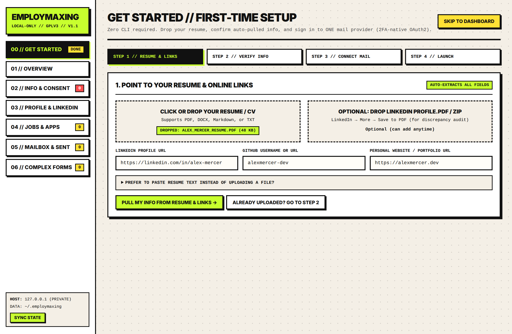
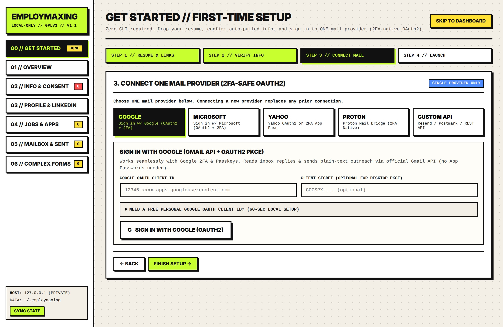
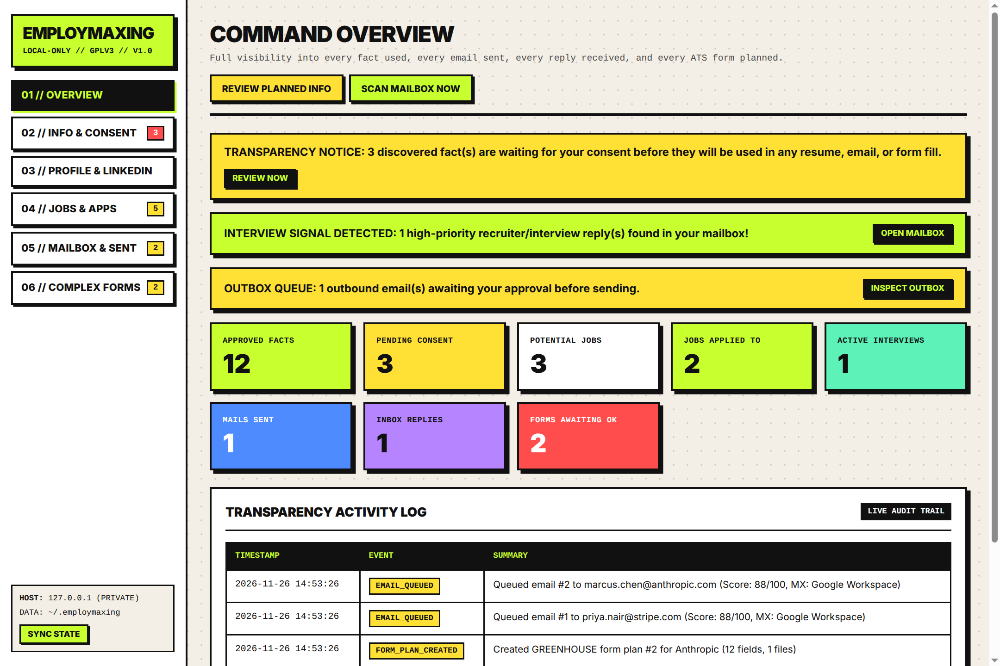
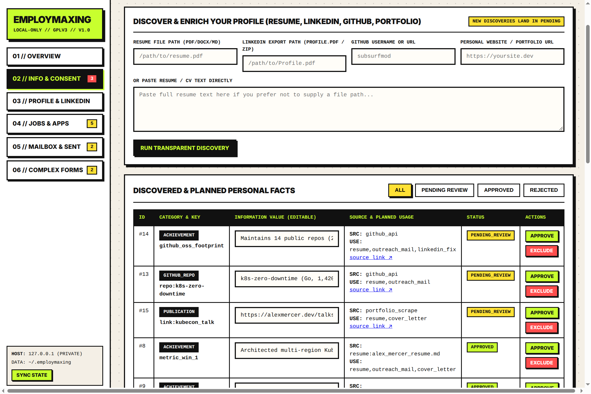
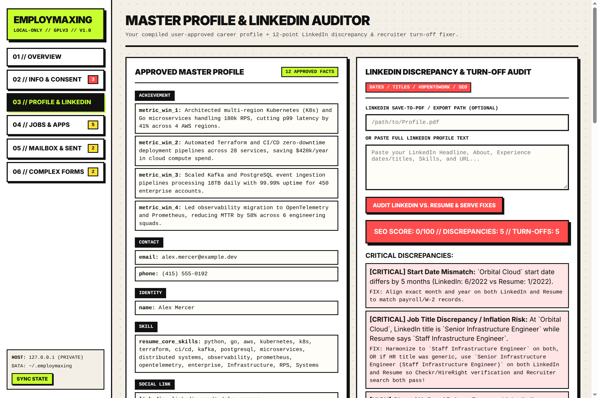
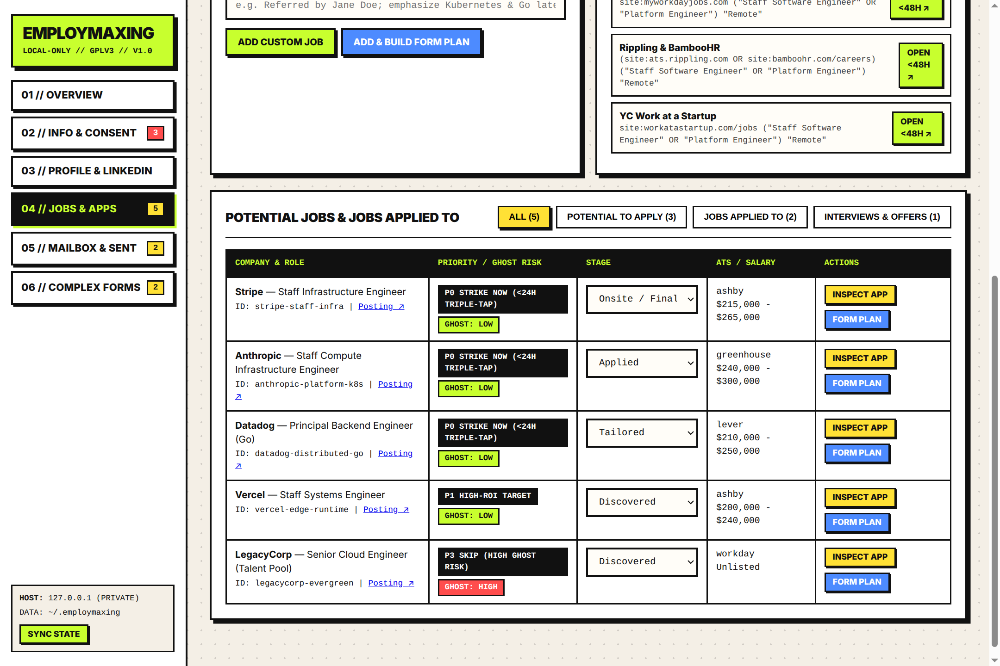
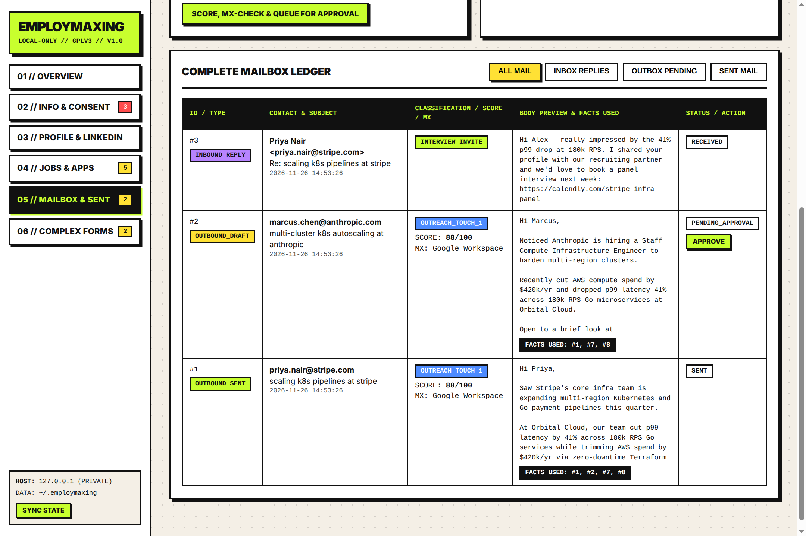
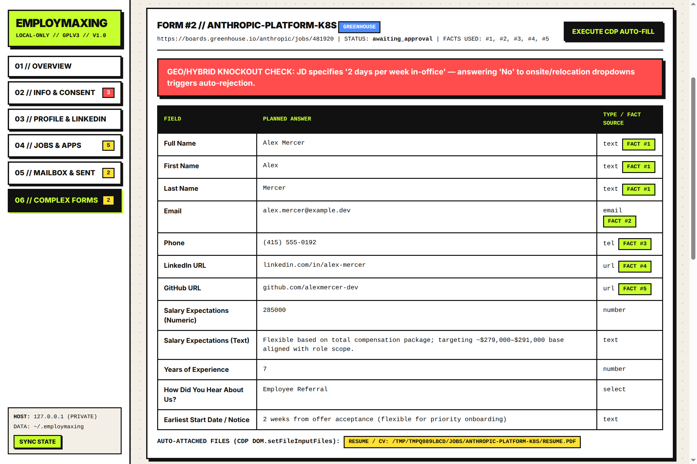

# EMPLOYMAXING

[](./LICENSE)
[](https://github.com/subsurfmod/Employmaxing/releases/tag/v1.1.0)
[](./SKILL.md)
[](https://www.python.org/)
[](./employmaxing/server.py)

> **Empirical Interview-Maximization & Transparent Career Automation Agent Skill** — Launch once (`./bin/employmaxing serve`) to auto-open a Neo-Brutalist High-Contrast Local Web App with a **Zero-CLI First-Time Setup Wizard** (drag-and-drop resume upload + auto-extraction), **2FA-Safe Single-Provider OAuth2 Mail** (Sign in with Google / Sign in with Microsoft / Yahoo / Proton Bridge / Custom REST API), **12-Point LinkedIn Discrepancy Auditor**, and **Complex ATS Chrome CDP Form Filling**.
>
> **Works seamlessly with:** Antigravity, Claude Code, Claude Cowork, Standalone CLI (`employmaxing`), and any Browser (`http://127.0.0.1:8787`). | **License:** [GNU General Public License v3.0](./LICENSE)

---

## Visual Preview (Neo-Brutalist High-Contrast Local Web Dashboard)

### Zero-CLI First-Time Setup Wizard (Drop Resume & Auto-Pull Info)


### 2FA-Safe Single-Provider Mail OAuth2 (Google / Microsoft / Yahoo / Proton / Custom API)


### Command Overview & Live Audit Trail


### Information & Consent Ledger (Every Discovered Fact Requires Approval)


### Approved Master Profile & 12-Point LinkedIn Discrepancy Auditor


### Custom Job Input, `<48h` Direct ATS Radar, Potential Jobs & Jobs Applied To


### Mailbox Reply Monitor (`INTERVIEW_INVITE`), Outbox Queue & Sent Mail Ledger


### Complex ATS Form Fills (75th-Pct Salary Anchor, Knockout Warnings & CDP PDF Uploads)


---

## Why Employmaxing?

Cold portal applications convert at **1–2%**, ~25% of online listings are **ghost jobs**, and ~85% of recruiters silently disqualify shortlisted candidates over **LinkedIn-vs-Resume date/title discrepancies, `#OpenToWork` stigma, bloated >800w resumes, cold-email PDF spam quarantine, or accidental ATS knockout answers**.

**Employmaxing** encodes empirical hiring research (TheLadders 6s F-pattern eye-tracking, TalentWorks 125k-resume word-count & metric studies, Google X-Y-Z bullet structure, Lavender & Gong cold-email benchmarks, and real Greenhouse/Lever/Ashby/Workday ATS mechanics) into an automated, **100% transparent** Agent Skill + local non-CLI web app.

---

## Core Capabilities

1. **Complete Profile Discovery + Transparent Consent Ledger (`employmaxing/enricher.py`, `employmaxing/store.py`)**
   - Extracts facts from your **Resume/CV (PDF/DOCX/MD)**, **LinkedIn export**, **GitHub public API** (stars, top repos, languages), and **Personal Website/Portfolio**.
   - **Zero surprises**: Every discovered fact lands in `pending_review` with its exact `source`, `source_url`, and `planned_usage`. Nothing is inserted into a resume, email, or form fill until you approve it.
2. **Neo-Brutalist High-Contrast Local Web Dashboard (`http://127.0.0.1:8787`)**
   - Full non-CLI interface built on zero-framework Python stdlib `ThreadingHTTPServer` + SQLite (`~30 MB RAM`, private `127.0.0.1` loopback only):
     - **01 // Overview** — Live KPIs, urgent consent/interview alerts, and Transparency Audit Trail
     - **02 // Info & Consent** — Discover, edit, approve, or exclude every planned personal fact
     - **03 // Profile & LinkedIn** — Compiled approved Master Profile + 1-click LinkedIn Discrepancy & Turn-Off Fixes
     - **04 // Jobs & Apps** — `<48h` direct ATS radar, ghost-job triage, custom application inspector, and PDF/DOCX downloads
     - **05 // Mailbox & Sent** — IMAP reply monitor, interview auto-classifier, Outbox approval queue, and Sent Mail ledger
     - **06 // Complex Forms** — Field-by-field knockout-safe ATS plans, native CDP PDF uploads, and pre-submit verification screenshots
3. **12-Point LinkedIn Discrepancy & Recruiter Turn-Off Auditor (`shared/scripts/linkedin_audit.py`)**
   - Detects `>1 month` date drift, title inflation, ghost/missing roles, simultaneous `"Present"` roles (overemployment suspicion), public green `#OpenToWork` stigma, desperation headlines, unframed `<12mo` short stints, uncustomized hex URL slugs, `<500` connections, and LinkedIn Recruiter Boolean SEO gaps — serving ready-to-paste **220-char Headlines**, **About Section**, **Canonical Timeline Lock**, and **Top-20 Skills**.
4. **Mailbox Reply Monitor & Automated Plain-Text Sender (`employmaxing/mailbox.py`)**
   - Scans your IMAP inbox for recruiter/HM replies, automatically classifies `interview_invite`, `recruiter_screen`, `assessment`, `offer`, and `rejection`, and updates your job pipeline.
   - Scores outbound drafts against Lavender/Gong rules (`45–95w`, `3–6w` lowercase subject, Grade `<=6.5`, **0 attachments on Touch #1**), verifies live **DNS MX gateways** (`Google Workspace`, `M365 Defender`, `Proofpoint`, `Mimecast`), logs `facts_used`, and sends approved mail via SMTP with safe daily rate limits.
5. **Complex ATS Form Filling (`employmaxing/form_filler.py`)**
   - Supports **Ashby, Greenhouse (auto iframe breakout), Lever, BambooHR, Workday, SmartRecruiters, and Rippling**.
   - Computes **75th-percentile salary anchors** from posted bands, defensible YOE, and knockout warnings.
   - Uses a zero-dependency **Chrome DevTools Protocol (CDP)** client with native React/SPA prototype value setters, **real `<input type="file">` PDF/DOCX uploads (`DOM.setFileInputFiles`)**, and full-page pre-submit review screenshots.
6. **Empirical Quality Gates & ATS PDF/DOCX Export (`shared/scripts/optimizer.py`, `shared/scripts/export_document.py`)**
   - Blocks resumes below **85/100** (475–650w sweet spot, >=70% XYZ quantified bullets, >=80% exact+acronym JD keyword parity, zero AI clichés/em-dashes) and compiles clean single-column PDFs (via headless Chrome) + `.docx`.

---

## Installation

### 1. Clone & Install Python Dependencies
```bash
git clone https://github.com/subsurfmod/Employmaxing.git
cd Employmaxing
pip install pypdf python-docx markdown requests beautifulsoup4
chmod +x bin/employmaxing
```

### 2. Install as an Agent Skill (Antigravity / Claude Code)
```bash
# Antigravity (symlink into ~/.agents/skills/)
ln -sfn "$(pwd)" ~/.agents/skills/employmaxing

# Optional: global CLI shortcut
ln -sfn "$(pwd)/bin/employmaxing" ~/.local/bin/employmaxing
```

### 3. Launch the Local Web Dashboard
```bash
./bin/employmaxing serve
# Open http://127.0.0.1:8787
```

---

## Privacy & Security

- **100% Local-First**: Your SQLite database (`~/.employmaxing/employmaxing.db`), resumes, LinkedIn snapshots, and `mail-config.json` (`chmod 600`) never leave your machine except when *you* explicitly approve an email send or ATS form fill.
- **Loopback Only**: The web server binds exclusively to `127.0.0.1`.

## License

Copyright (C) 2026 subsurfmod. Licensed under the **GNU General Public License v3.0 (GPL-3.0-or-later)**. See [LICENSE](./LICENSE) and [NOTICE](./NOTICE).
